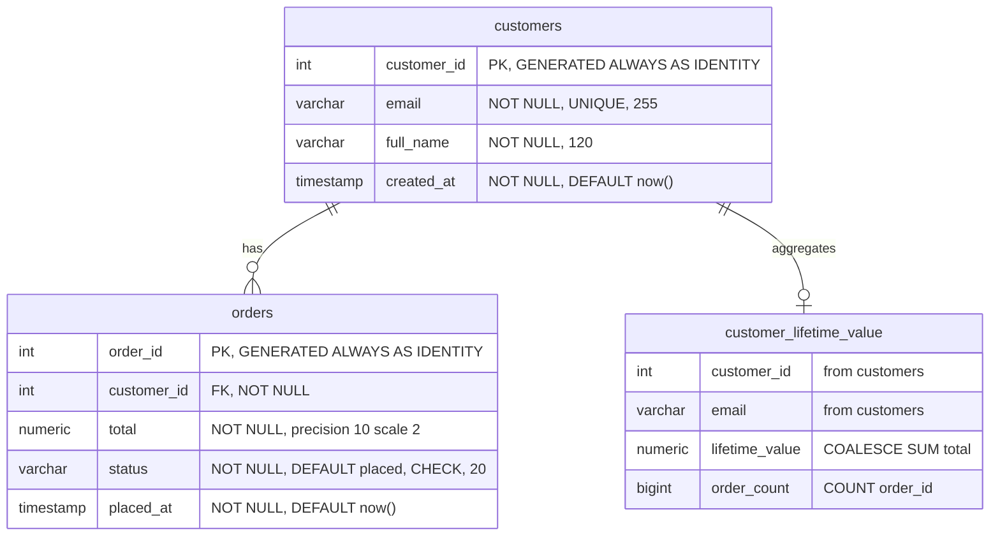

# Locked Decisions for Story 2b31c007-8f91-49ba-a71a-817f025807fc

## Implementation Approach
### Decision
Produce a single PostgreSQL DDL script at `sql/schema.sql` that creates all 3 objects in dependency order, applying the locked type mappings and dialect substitutions from the source `random-2/sql/schema.sql`.

### Deliverable
One file: **`sql/schema.sql`** — a self-contained DDL script that creates:
1. `public.customers` table (4 columns)
2. `public.orders` table (5 columns, FK → customers)
3. `public.customer_lifetime_value` view (LEFT JOIN aggregate)

### Translation Rules Applied
All 4 locked type mappings and all 4 dialect substitutions are deterministic find-and-replace — no hand-rewrite or semantic analysis:

| # | Rule | Source | Target |
|---|---|---|---|
| 1 | Type: identity | `INT IDENTITY(1,1)` | `INT GENERATED ALWAYS AS IDENTITY` |
| 2 | Type: string | `NVARCHAR(n)` | `VARCHAR(n)` |
| 3 | Type: decimal | `DECIMAL(10,2)` | `NUMERIC(10,2)` |
| 4 | Type: datetime | `DATETIME2` | `TIMESTAMP` |
| 5 | Dialect: null coalesce | `ISNULL(expr, default)` | `COALESCE(expr, default)` |
| 6 | Dialect: UTC time | `SYSUTCDATETIME()` | `now()` |
| 7 | Dialect: unicode prefix | `N'literal'` | `'literal'` |
| 8 | Dialect: batch separator | `GO` | *(removed)* |

### Identifier Convention
All identifiers lowercased to snake_case per the locked Schema & Type Mapping decision:
- `CustomerId` → `customer_id`, `FullName` → `full_name`, `CreatedAt` → `created_at`
- `OrderId` → `order_id`, `PlacedAt` → `placed_at`
- `CustomerLifetimeValue` → `customer_lifetime_value`
- `LifetimeValue` → `lifetime_value`, `OrderCount` → `order_count`

### Dependency Order
The script executes statements in this order:
1. `CREATE TABLE customers` — no dependencies
2. `CREATE TABLE orders` — depends on `customers` (FK)
3. `CREATE VIEW customer_lifetime_value` — depends on both tables

### Width Ground Truth
The story explicitly notes the TRD mapping table has Email and FullName widths swapped. The **source DDL is ground truth**:
- `Email` → `NVARCHAR(255)` → `VARCHAR(255)` ✓
- `FullName` → `NVARCHAR(120)` → `VARCHAR(120)` ✓

### What Is NOT Built
- No migration tooling (Flyway, Liquibase) — per locked CI/CD decision
- No additional indexes beyond those auto-created by PK/UNIQUE constraints — per locked Performance decision
- No FK index on `orders.customer_id` — deliberately deferred per TRD
- No seed data in the DDL script — per locked Ingestion decision
- No `DROP IF EXISTS` guards — the harness runs against a clean database each time

## Data Mapping
### Decision
1:1 structural mapping from `dbo` → `public`. All 3 source objects carry forward with identical structure; only identifiers and types are translated per the locked decisions.

### Target ER Diagram

### Column Mapping — customers (dbo.Customers → public.customers)

| # | Source Column | Source Type | Target Column | Target Type | Constraints | Default |
|---|---|---|---|---|---|---|
| 1 | `CustomerId` | `INT IDENTITY(1,1)` | `customer_id` | `INT GENERATED ALWAYS AS IDENTITY` | PK | *(identity)* |
| 2 | `Email` | `NVARCHAR(255)` | `email` | `VARCHAR(255)` | NOT NULL, UNIQUE | — |
| 3 | `FullName` | `NVARCHAR(120)` | `full_name` | `VARCHAR(120)` | NOT NULL | — |
| 4 | `CreatedAt` | `DATETIME2` | `created_at` | `TIMESTAMP` | NOT NULL | `now()` |

### Column Mapping — orders (dbo.Orders → public.orders)

| # | Source Column | Source Type | Target Column | Target Type | Constraints | Default |
|---|---|---|---|---|---|---|
| 1 | `OrderId` | `INT IDENTITY(1,1)` | `order_id` | `INT GENERATED ALWAYS AS IDENTITY` | PK | *(identity)* |
| 2 | `CustomerId` | `INT` | `customer_id` | `INT` | NOT NULL, FK → customers(customer_id) | — |
| 3 | `Total` | `DECIMAL(10,2)` | `total` | `NUMERIC(10,2)` | NOT NULL | — |
| 4 | `Status` | `NVARCHAR(20)` | `status` | `VARCHAR(20)` | NOT NULL, CHECK IN ('placed','shipped','delivered') | `'placed'` |
| 5 | `PlacedAt` | `DATETIME2` | `placed_at` | `TIMESTAMP` | NOT NULL | `now()` |

### View Mapping — customer_lifetime_value (dbo.CustomerLifetimeValue → public.customer_lifetime_value)

| # | Source Expression | Target Expression | Notes |
|---|---|---|---|
| 1 | `c.CustomerId` | `c.customer_id` | Pass-through from customers |
| 2 | `c.Email` | `c.email` | Pass-through from customers |
| 3 | `ISNULL(SUM(o.Total), 0) AS LifetimeValue` | `COALESCE(SUM(o.total), 0) AS lifetime_value` | ISNULL → COALESCE swap |
| 4 | `COUNT(o.OrderId) AS OrderCount` | `COUNT(o.order_id) AS order_count` | Identifier casing only |

### Constraint Mapping Summary

| Constraint | Source | Target |
|---|---|---|
| PK | `Customers(CustomerId)` | `customers(customer_id)` |
| PK | `Orders(OrderId)` | `orders(order_id)` |
| UNIQUE | `Customers(Email)` | `customers(email)` |
| FK | `Orders(CustomerId) → Customers(CustomerId)` | `orders(customer_id) → customers(customer_id)` |
| CHECK | `Status IN (N'placed', N'shipped', N'delivered')` | `status IN ('placed', 'shipped', 'delivered')` |
| NOT NULL | All 9 columns | All 9 columns |
| DEFAULT | `CreatedAt = SYSUTCDATETIME()` | `created_at = now()` |
| DEFAULT | `PlacedAt = SYSUTCDATETIME()` | `placed_at = now()` |
| DEFAULT | `Status = N'placed'` | `status = 'placed'` |

### Notes
- No tables split, merged, or restructured — pure 1:1 carry
- No columns added, removed, or retyped beyond the locked mappings
- No existing tables in the destination project to integrate with (project is empty)
- View column `order_count` will be `BIGINT` in PostgreSQL (`COUNT()` returns `BIGINT`)

## Validation
### Decision
Validation is handled by the platform's MVS declarative build-and-verify harness. The DDL script is executed against a clean scratch PostgreSQL instance, and all 8 acceptance criteria are asserted against the **live PostgreSQL catalog** — no offline or parse-only checks.

### Harness Execution Flow
1. The harness boots a clean PostgreSQL instance with an empty `public` schema
2. The DDL script (`sql/schema.sql`) is executed in order: `customers` → `orders` → `customer_lifetime_value`
3. Each acceptance criterion is verified via SQL queries against the live catalog

### Acceptance Criteria → Validation Queries

| AC# | What's Checked | Catalog Source | Pass Condition |
|---|---|---|---|
| 1 | 3 objects CREATE without error | DDL execution result + `pg_tables`, `pg_views` | 0 errors, 3 objects found |
| 2 | 9 columns: name, type, precision, nullability, defaults | `information_schema.columns` vs source spec | 9/9 match on all dimensions |
| 3 | Object types preserved (table vs view) | `information_schema.tables`, `information_schema.views` | 2 BASE TABLE, 1 VIEW |
| 4 | All constraints present | `pg_constraint` (contype p/f/u/c) + `information_schema.columns` for defaults | 2 PK + 1 FK + 1 UNIQUE + 1 CHECK + 3 DEFAULT |
| 5 | FK type consistency | `pg_constraint` join to column types | `orders.customer_id` (int) → `customers.customer_id` (int) |
| 6 | SELECT * succeeds on all 3 objects + smoke insert | Live queries | 0 errors, view returns correct COALESCE result |
| 7 | Every object has recorded CREATE + SELECT evidence | Harness execution log | 3/3 verified |
| 8 | All evidence is live-catalog, not offline | Harness execution context | 8/8 live |

### Smoke Test (AC6 detail)
After DDL creation, the harness runs:
1. `SELECT * FROM public.customers` — 0 rows, no error
2. `SELECT * FROM public.orders` — 0 rows, no error
3. `SELECT * FROM public.customer_lifetime_value` — 0 rows, no error
4. `INSERT INTO customers (full_name, email) VALUES ('Test User', 'test@example.com')` — exercises IDENTITY + DEFAULT now()
5. `SELECT * FROM customer_lifetime_value` — returns 1 row with `lifetime_value = 0`, `order_count = 0` (validates COALESCE null-handling)

### Constraint Verification Queries
- **PKs**: `SELECT conname FROM pg_constraint WHERE contype = 'p'` — expect 2
- **FK**: `SELECT conname FROM pg_constraint WHERE contype = 'f'` — expect 1, referencing `customers(customer_id)`
- **UNIQUE**: `SELECT conname FROM pg_constraint WHERE contype = 'u'` — expect 1 on `email`
- **CHECK**: `SELECT conname FROM pg_constraint WHERE contype = 'c'` — expect CHECK with `status` IN clause (excluding NOT NULL checks which PostgreSQL also stores as contype 'c')
- **DEFAULTS**: `SELECT column_name, column_default FROM information_schema.columns WHERE column_default IS NOT NULL` — expect `now()` on `created_at`/`placed_at`, `'placed'` on `status`

### Edge Cases Handled
- **GENERATED ALWAYS AS IDENTITY**: INSERT without specifying `customer_id` must auto-assign; INSERT *with* `customer_id` must fail (unless `OVERRIDING SYSTEM VALUE`)
- **NOT NULL on all 9 columns**: No column accepts NULL — verified via `information_schema.columns.is_nullable = 'NO'`
- **CHECK constraint values**: Only `'placed'`, `'shipped'`, `'delivered'` — no N-prefix remnants
- **View column types**: `lifetime_value` is `NUMERIC` (from SUM of NUMERIC), `order_count` is `BIGINT` (from COUNT)
- **Empty-table aggregation**: The view must return 0 (not NULL) for `lifetime_value` when a customer has no orders — validated by the smoke insert test
