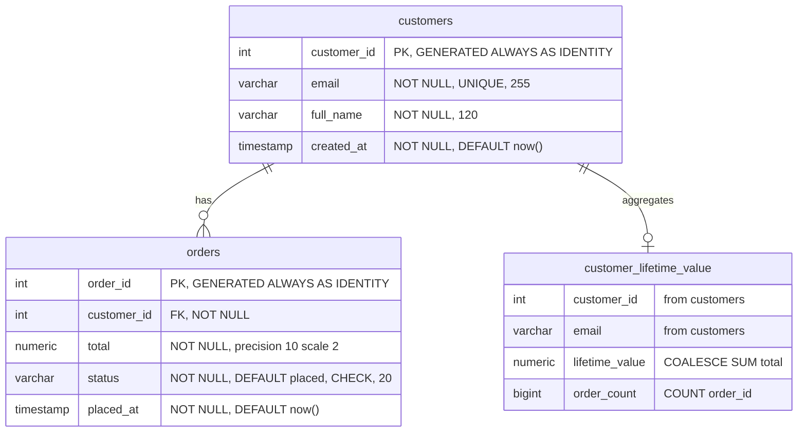

# Data Mapping

### Decision
1:1 structural mapping from `dbo` → `public`. All 3 source objects carry forward with identical structure; only identifiers and types are translated per the locked decisions.

### Target ER Diagram

### Column Mapping — customers (dbo.Customers → public.customers)

| # | Source Column | Source Type | Target Column | Target Type | Constraints | Default |
|---|---|---|---|---|---|---|
| 1 | `CustomerId` | `INT IDENTITY(1,1)` | `customer_id` | `INT GENERATED ALWAYS AS IDENTITY` | PK | *(identity)* |
| 2 | `Email` | `NVARCHAR(255)` | `email` | `VARCHAR(255)` | NOT NULL, UNIQUE | — |
| 3 | `FullName` | `NVARCHAR(120)` | `full_name` | `VARCHAR(120)` | NOT NULL | — |
| 4 | `CreatedAt` | `DATETIME2` | `created_at` | `TIMESTAMP` | NOT NULL | `now()` |

### Column Mapping — orders (dbo.Orders → public.orders)

| # | Source Column | Source Type | Target Column | Target Type | Constraints | Default |
|---|---|---|---|---|---|---|
| 1 | `OrderId` | `INT IDENTITY(1,1)` | `order_id` | `INT GENERATED ALWAYS AS IDENTITY` | PK | *(identity)* |
| 2 | `CustomerId` | `INT` | `customer_id` | `INT` | NOT NULL, FK → customers(customer_id) | — |
| 3 | `Total` | `DECIMAL(10,2)` | `total` | `NUMERIC(10,2)` | NOT NULL | — |
| 4 | `Status` | `NVARCHAR(20)` | `status` | `VARCHAR(20)` | NOT NULL, CHECK IN ('placed','shipped','delivered') | `'placed'` |
| 5 | `PlacedAt` | `DATETIME2` | `placed_at` | `TIMESTAMP` | NOT NULL | `now()` |

### View Mapping — customer_lifetime_value (dbo.CustomerLifetimeValue → public.customer_lifetime_value)

| # | Source Expression | Target Expression | Notes |
|---|---|---|---|
| 1 | `c.CustomerId` | `c.customer_id` | Pass-through from customers |
| 2 | `c.Email` | `c.email` | Pass-through from customers |
| 3 | `ISNULL(SUM(o.Total), 0) AS LifetimeValue` | `COALESCE(SUM(o.total), 0) AS lifetime_value` | ISNULL → COALESCE swap |
| 4 | `COUNT(o.OrderId) AS OrderCount` | `COUNT(o.order_id) AS order_count` | Identifier casing only |

### Constraint Mapping Summary

| Constraint | Source | Target |
|---|---|---|
| PK | `Customers(CustomerId)` | `customers(customer_id)` |
| PK | `Orders(OrderId)` | `orders(order_id)` |
| UNIQUE | `Customers(Email)` | `customers(email)` |
| FK | `Orders(CustomerId) → Customers(CustomerId)` | `orders(customer_id) → customers(customer_id)` |
| CHECK | `Status IN (N'placed', N'shipped', N'delivered')` | `status IN ('placed', 'shipped', 'delivered')` |
| NOT NULL | All 9 columns | All 9 columns |
| DEFAULT | `CreatedAt = SYSUTCDATETIME()` | `created_at = now()` |
| DEFAULT | `PlacedAt = SYSUTCDATETIME()` | `placed_at = now()` |
| DEFAULT | `Status = N'placed'` | `status = 'placed'` |

### Notes
- No tables split, merged, or restructured — pure 1:1 carry
- No columns added, removed, or retyped beyond the locked mappings
- No existing tables in the destination project to integrate with (project is empty)
- View column `order_count` will be `BIGINT` in PostgreSQL (`COUNT()` returns `BIGINT`)
